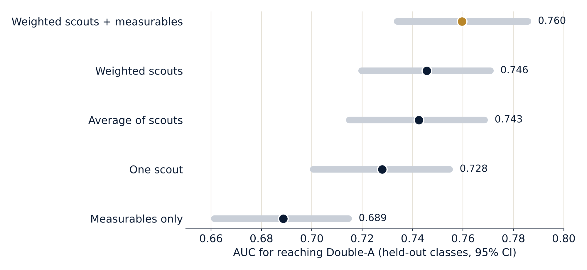
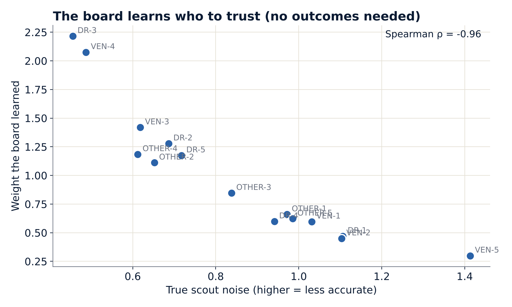
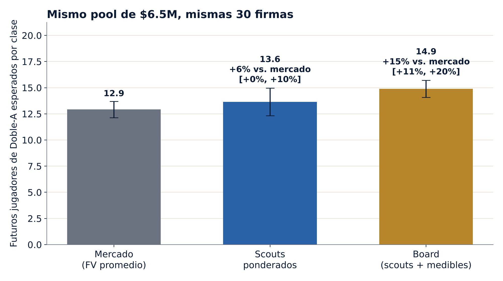
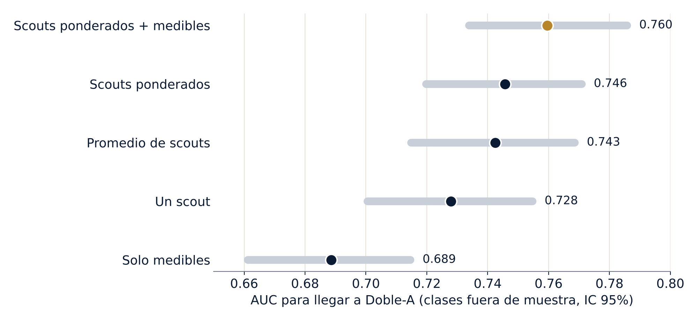
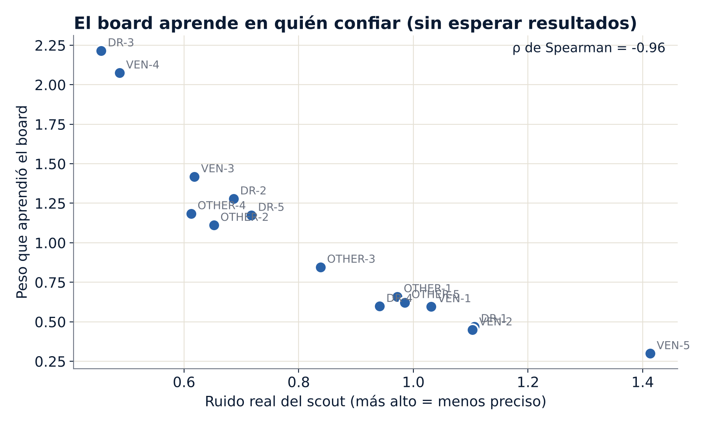

# EP Prospect Board: Turning Several Scout Reports Into One Signing Decision

**Headline (CONFIRMED, in simulation):** with the same $6.5M bonus pool and the same 30 signings per class, a board that combines **bias-corrected scout reports with measurables** lands **15% more future Double-A players** than signing by average FV (14.9 vs 12.9 per class, 95% CI +11% to +20%, 5 held-out classes of 400 prospects).

> **Everything here is simulated.** Real scouting grades and bonuses are private. The world is built with known truth so the method can be tested honestly. It shows **how** a club could combine reports and data, not how any real club's system performs.

**Decision question:** when several scouts see the same international prospect, how should their reports be combined with measurables to rank players and spend a capped bonus pool?

| Strategy (same pool, 30 signings) | Expected future AA players per class | vs market [95% CI] | Label |
|---|---|---|---|
| Market: highest average FV | 12.9 | — | baseline |
| Weighted scouts (bias-corrected) | 13.6 | +6% [+0%, +10%] | NOT CONFIRMED |
| **Board: weighted scouts + measurables** | **14.9** | **+15% [+11%, +20%]** | **CONFIRMED** |


## Key findings

1. **The money is where the edge is (CONFIRMED, simulation).** Ranking improves only a little (AUC 0.743 → 0.760), but spending a capped pool on the better ranking turns that small gain into 15% more future Double-A players. The board finds productive players the market prices low.
2. **The board learns which scouts to trust without waiting for outcomes (CONFIRMED, simulation).** Comparing each scout with the other scouts who saw the same player, the learned weights track true scout accuracy (Spearman ρ = −0.96), and the learned bias and maturity lean track the real ones (ρ = 0.81 and 0.93). A club can update this the same summer.
3. **Weighting scouts matters only when scouts differ a lot (INTERPRETATION).** In the main world the gain over a plain average is small (AUC +0.003, not confirmed). In the known-answer check with very different scouts it is clear (+0.029). The value of weighting depends on how uneven the staff is.
4. **Measurables alone are not enough.** Measurables without scouts reach AUC 0.689, below even one scout (0.728). They add value on top of the reports (+0.014, CI above zero, below the 0.02 rule).




### Example board (last held-out class, top 10)

Synthetic players. The 80% interval reflects model uncertainty only.

| Board rank | Market rank | Region | Age | Reports | Avg FV | Bonus ask | P(reach AA) [80%] | P per $100k | Reached AA |
|---|---|---|---|---|---|---|---|---|---|
| 1 | 1 | VEN | 17.5 | 4 | 68.8 | $3,500k | 0.85 [0.84–0.87] | 0.02 | Yes |
| 2 | 4 | VEN | 16.9 | 3 | 65.0 | $1,513k | 0.81 [0.79–0.84] | 0.05 | No |
| 3 | 2 | VEN | 17.5 | 3 | 68.3 | $2,235k | 0.77 [0.75–0.80] | 0.03 | No |
| 4 | 4 | DR | 17.2 | 4 | 65.0 | $2,033k | 0.75 [0.72–0.77] | 0.04 | No |
| 5 | 7 | OTHER | 17.1 | 3 | 63.3 | $1,049k | 0.71 [0.68–0.73] | 0.07 | Yes |
| 6 | 15 | DR | 16.3 | 3 | 60.0 | $267k | 0.70 [0.68–0.72] | 0.26 | Yes |
| 7 | 34 | OTHER | 16.3 | 2 | 57.5 | $346k | 0.69 [0.66–0.72] | 0.20 | Yes |
| 8 | 2 | DR | 17.0 | 3 | 68.3 | $3,500k | 0.69 [0.66–0.72] | 0.02 | Yes |
| 9 | 14 | DR | 17.0 | 4 | 61.2 | $435k | 0.69 [0.66–0.71] | 0.16 | Yes |
| 10 | 4 | DR | 17.6 | 4 | 65.0 | $1,115k | 0.69 [0.66–0.72] | 0.06 | Yes |

Rows 6, 7 and 9 are the board's edge: younger players with good tools whom the market ranks 14th to 34th and prices at $267k–$435k.

## How it works

| Step | What the board does |
|---|---|
| 1. Collect | 2–4 reports per prospect (FV on the 20–80 scale) from regional scouts, plus bat speed, exit velocity, sprint and age |
| 2. Learn each scout | Compare each scout with the others who saw the same player: estimate his bias, his lean toward physically mature (older) players, and his noise. Training classes only, no outcomes needed |
| 3. Combine | Correct each grade, then weight it by 1 / the scout's noise |
| 4. Predict | Logistic model: weighted grade + measurables + age → probability of reaching Double-A, trained on past classes |
| 5. Spend | Sign 30 players that maximize total probability within the pool (same optimizer for every strategy; only the ranking differs) |

## The simulated world

| Item | Setting |
|---|---|
| Classes | 20 classes × 400 prospects; learn on classes 1–15, test on the 5 held-out classes 16–20 (2,000 prospects) |
| Scouts | 15 (5 per region: DR 50%, VEN 35%, OTHER 15% of prospects); noise 0.45–1.5, bias ±0.4, maturity lean 0–0.5 (talent units) |
| Truth | Latent talent T ~ N(0, 1); P(reach AA) = logistic(−1.75 + 1.35 T); base rate 21% |
| Measurables | Bat speed, exit velo and sprint load 0.55, 0.45 and 0.30 on talent, and all rise with age (maturity), which the model must separate from talent |
| Market | Asking bonus follows the public consensus (average FV + bat speed): median ~$41k, top asks $1.5–3.5M |
| Pool | $6.5M per class, 30 signings |

**Rules fixed before running:** ranking → CONFIRMED if the AUC gain is ≥ 0.02 and its paired bootstrap 95% CI is above zero. Budget → CONFIRMED if expected hits rise ≥ 10% and the bootstrap 95% CI over classes is above zero.

## Known-answer checks (both directions)

Run before trusting the results: `python tests/test_known_answer.py`

| World | Expected | Result |
|---|---|---|
| Identical scouts | No gain from weighting | +0.000 [−0.001, +0.001] ✓ |
| Very different scouts | Gain from weighting | +0.029 [+0.017, +0.041] ✓ |
| Measurables are pure noise | No gain from measurables | +0.006 [+0.001, +0.013] ✓ |
| Measurables tied to talent | Gain from measurables | +0.040 [+0.027, +0.053] ✓ |

## Reproduce

```bash
pip install -r requirements.txt
python tests/test_known_answer.py          # ~1 min
python src/evaluate.py results             # ~1 min
python src/charts.py results figures en
python src/charts.py results figures/es es
```

## Limits

- **Simulated, not real.** The size of every gain depends on the assumptions above. With a club's own reports and bonuses, the same code would measure the real gain.
- The outcome is reaching Double-A, not value in the majors.
- The budget confidence interval rests on 5 held-out classes.
- The board's interval covers model uncertainty only, not disagreement between scouts.
- Real scouts can share a bias (for example, a whole region overrating one profile). Comparing scouts with each other cannot detect a bias they all share; that needs outcomes.

## How this connects to real data

The [EP International Pipeline](https://github.com/ejimenezperformance/ep-international-pipeline) study uses public DSL data to show that first-season performance predicts reaching Double-A (AUC 0.57 → 0.74). This repo is the step before signing: how to read the reports. With club data, the two link up: signing evaluations scored against DSL results, by scout and by region.

## Corrections log

- **v1.0:** the first version weighted scouts by their raw disagreement with the others, which mixes their noise with the other scouts' noise and understates differences. The known-answer check with very different scouts caught it (gain +0.019, below the rule). Fixed with a method-of-moments estimate of each scout's own noise; all results above use the fix.

---

## Resumen en español

**Hallazgo (CONFIRMED, en simulación):** con el mismo pool de $6.5M y las mismas 30 firmas por clase, un board que combina **reportes de scouts corregidos por sesgo con datos medibles** consigue **15% más futuros jugadores de Doble-A** que firmar por FV promedio (14.9 vs. 12.9 por clase, IC 95% de +11% a +20%, en 5 clases fuera de muestra de 400 prospectos).

> **Todo es simulado.** Las notas de los scouts y los bonos reales son privados. El mundo se construyó con la verdad conocida para probar el método con honestidad. Muestra **cómo** un club podría combinar reportes y datos, no cómo funciona el sistema de ningún club real.

**Pregunta de decisión:** cuando varios scouts ven al mismo prospecto internacional, ¿cómo combinar sus reportes con los datos medibles para ordenar a los jugadores y gastar un pool de bonos con tope?

1. **La ventaja está en cómo se gasta el dinero (CONFIRMED, simulación).** El ranking mejora poco (AUC de 0.743 a 0.760), pero al gastar el pool con ese mejor ranking se consiguen 15% más futuros jugadores de Doble-A. El board encuentra jugadores productivos que el mercado valora bajo.
2. **El board aprende en qué scouts confiar sin esperar resultados (CONFIRMED, simulación).** Al comparar a cada scout con los otros que vieron al mismo jugador, los pesos aprendidos siguen la precisión real de cada scout (ρ = −0.96). Un club lo puede actualizar el mismo verano.
3. **Ponderar a los scouts solo importa cuando son muy distintos entre sí (INTERPRETATION).** En el mundo principal la ganancia sobre el promedio simple es pequeña; con scouts muy distintos es clara.
4. **Los datos medibles solos no alcanzan.** Sin scouts llegan a un AUC de 0.689, por debajo de un solo scout (0.728). Suman valor encima de los reportes.





**Pruebas de respuesta conocida:** las cuatro pasan. Con scouts iguales no hay ganancia por ponderar; con scouts muy distintos sí. Con medibles de puro ruido no hay ganancia; con medibles ligados al talento sí.

**Límites:** es una simulación, y el tamaño de cada ganancia depende de los supuestos. El resultado es llegar a Doble-A, no el valor en MLB. Si todos los scouts comparten un mismo sesgo, compararlos entre sí no lo detecta; para eso hacen falta resultados.

**Corrección v1.0:** la primera versión ponderaba a los scouts por su desacuerdo directo con los demás, lo que subestimaba las diferencias. La prueba de respuesta conocida lo detectó y se corrigió antes de publicar.

---

Emerson Jimenez · Emerson Performance · [ejimenezperformance.github.io](https://ejimenezperformance.github.io)
